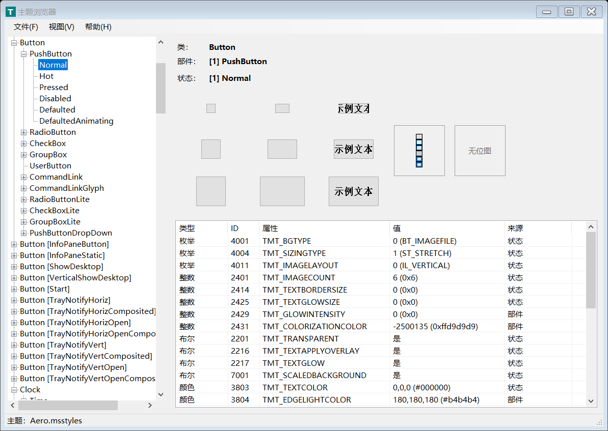
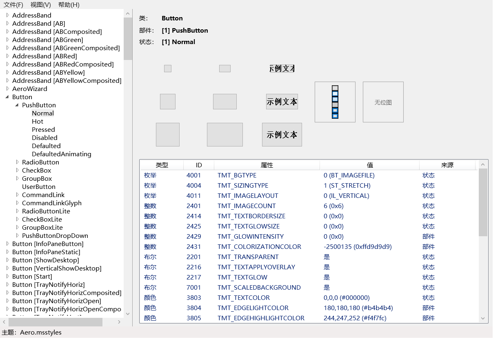

# 主题浏览器（.NET 版）

这是 [mity/theme-explorer](https://github.com/mity/theme-explorer) 的 C# 移植：一个用于浏览
Windows 视觉样式（主题，由 `UXTHEME.DLL` 提供）的小工具，同时把相关 API 封装成了可复用的类库。
仓库包含 WinForms 和 WPF 两套界面。

*英文版：[README.md](README.md)*





## 主要特性

- **.NET Framework 4.0**、**C# 6.0**、Visual Studio 2015 解决方案、**AnyCPU**
  （已验证以 64 位进程运行）。
- **ThemeExplorer.Core**：规范的 UXTHEME 封装——基于 `SafeHandle` 的生命周期管理、
  HRESULT 检查、强类型属性值、`Graphics`/`HDC` 两套绘制重载，以及动态解析
  `GetThemeBitmap` / `GetThemeStream`。
  文档：[中文 API 参考](docs/API.zh-CN.md) · [English](docs/API.md)。
- **ThemeExplorer.Ui**：共享的本地化资源、区域文化与属性值格式化，避免两套界面重复实现。
- **ThemeExplorer**（WinForms）与 **ThemeExplorer.Wpf**（WPF）：布局与原版一致——左侧
  类/部件/状态树，右侧 9 个部件预览、DIB/字形位图，下方属性表并标注每个值来自状态、部件、
  类还是全局默认值。
- **英语 + 简体中文**：卫星程序集资源；默认跟随系统语言，可在“视图 → 语言”中运行时切换，
  或使用 `--lang=zh-Hans` 启动。树中的常见类/部件/状态名已本地化；没有可靠译名的技术名称
  保留英文。
- **系统主题实时更新**：系统主题或颜色变化时，WinForms 版本会刷新当前选择。“视图 → 主题
  更改时自动更新”默认启用，可以关闭，并且不会改变树中当前选中的项。
- **WPF 内存管理**：不为每个预览创建 `HwndHost`；主题句柄即用即关；DIB/DC 全部在 `finally`
  中销毁；没有静态图像缓存。自检会做 150 次切换和 20 次窗口开关，检查 GDI/USER/句柄数量；
  详见 [WPF 内存设计与验证](docs/WPF.zh-CN.md)。
- 主题数据库（44 个类、153 个窗口子类、335 个部件、670 个状态、227 个 `TMT_*` 属性）
  由原版 `db.c` 自动生成，没有手工重打一遍。

## 相关项目：WPF 的 Win32 主题

[PresentationFramework.Theme](../PresentationFramework.Theme/README.md) 是配套的 WPF 主题库：
用当前 Win32 视觉样式绘制 Button、CheckBox、RadioButton、TextBox，并复用本项目的
`ThemeExplorer.Core` 互操作层。
## 系统要求

- Windows Vista 或更高版本，并启用了视觉样式（开发与测试环境为 Windows 10/11）。
  程序目标框架为 .NET Framework 4.0。
- 编译需要 Visual Studio 2015，或较新的 MSBuild + .NET Framework 4.0 targeting pack。

## 编译

用 Visual Studio 2015 打开 `ThemeExplorer.sln`，选择 `Release | Any CPU` 生成即可。

命令行：

```powershell
powershell -ExecutionPolicy Bypass -File .\build.ps1 -Configuration Release -SelfTest
```

或直接调用 MSBuild：

```powershell
msbuild ThemeExplorer.sln /p:Configuration=Release /p:Platform="Any CPU"
```

生成结果：

```
src\ThemeExplorer.App\bin\Release\ThemeExplorer.exe          （WinForms）
src\ThemeExplorer.Wpf\bin\Release\ThemeExplorer.Wpf.exe      （WPF）
...\ThemeExplorer.Core.dll、ThemeExplorer.Ui.dll
...\zh-Hans\ThemeExplorer.Ui.resources.dll
```

## 运行

```text
ThemeExplorer.exe     [--lang=en|zh-Hans] [--selftest --out=<目录>]
ThemeExplorer.Wpf.exe [--lang=en|zh-Hans] [--selftest --out=<目录>]
```

- 不指定 `--lang` 时跟随操作系统语言。所有中文区域都映射到简体中文（`zh-Hans`），
  其他语言回退到英语。
- `--selftest` 执行无界面自检（创建窗口、打开主题、枚举属性、切换语言），把日志和截图写到
  指定目录；WPF 版本还会测量句柄与内存。`build.ps1` 会运行两套自检。

## 使用类库

```csharp
using ThemeExplorer.Core;

// 每个 UI 线程一个上下文；它内部持有一个用于窗口子类的隐藏窗口。
using (var context = new VisualStyleContext())
using (VisualStyle style = context.Open("Button"))   // 未被主题定义时返回 null
{
    if (style == null)
        return;

    ThemePropertyInfo property;
    ThemePropertyValue value;
    if (ThemeDatabase.TryGetProperty(3802, out property)   // TMT_FILLCOLOR
        && style.TryGetProperty(1, 1, property, out value))
    {
        Console.WriteLine("{0} = {1}（来源：{2}）", property.Name, value,
            style.GetPropertyOrigin(1, 1, property.Id));
    }

    using (Bitmap bitmap = ThemeRenderer.GetBitmap(style, 1, 1, ThemeBitmapKind.Background))
    {
        // bitmap 是托管副本，主题句柄之后可以立即释放。
    }
}
```

主要 API：

| 类型 | 作用 |
| --- | --- |
| `VisualStyleContext` | 持有隐藏窗口；`Open(className, subClass)` 返回 `VisualStyle`。 |
| `VisualStyle` | 强类型 `TryGetInt/Bool/Color/String/Margins/Rect/Position/PartSize/Font/IntList/Stream`、`GetPropertyOrigin`、`IsPartDefined`。 |
| `ThemeDatabase` | 只读的类/部件/状态/属性目录。 |
| `ThemeRenderer` | `TryDrawBackground` / `TryDrawText`（`Graphics` 或 `HDC`）、`GetBitmap`、`IsBackgroundPartiallyTransparent`。 |
| `ThemeSystem` | `IsVisualStylesEnabled`、`IsAppThemed`、`GetCurrentTheme()`。 |
| `ThemePropertyValue` | 带 `Type` 的强类型值（`IntValue`、`ColorValue`、`MarginsValue` 等）。 |

所有 `Try*` 方法在主题未定义相应部件/状态/属性时返回 `false` 而不是抛异常——浏览主题时这是常态。
完整说明见[中文 API 参考](docs/API.zh-CN.md)。

## 内存与生命周期

- `VisualStyleContext` 和 `VisualStyle` 都实现 `IDisposable`；每次选择打开一个主题，生成完
  图像和属性行后立即关闭。
- `GetBitmap` 返回托管副本，转换成 WPF/WinForms 图像后应立即 `Dispose`。
- 类库不保留任何静态句柄或图像缓存。
- WPF 不为每个预览创建子窗口；GDI 桥接在 `finally` 中销毁 DIB/DC。
- WPF 自检（150 次切换 + 20 次窗口开关）结果：GDI 增量 0、USER/进程句柄在 ±2 内、托管堆
  约 +4 KB；纯渲染路径基本不增长。commit/working set 受 WPF 内部缓存影响，只记录不作断言。原理与数据见
  [WPF 内存设计与验证](docs/WPF.zh-CN.md)。

## 与原版 C 实现的差异

- 在 Windows 10/11 上，`GetThemePropertyOrigin` 对不存在的属性 id 也会返回 `PO_GLOBAL`，
  因此两套界面默认隐藏没有值的行；“视图 → 显示所有属性”可恢复原版完整的 227 行行为。
- `TMT_SIZE` 只对 `TS_MIN`/`TS_TRUE`/`TS_DRAW`（0–2）这三个伪 id 查询——只有它们才是合法的
  `THEMESIZE` 参数。原版直接把属性 id（207）当作 `THEMESIZE` 传入。
- 支持 DPI 感知布局、可调整的属性列宽、本地化的类型/来源名称，以及无位图时的占位提示。
- 不从 `mctrl.org` 下载任何二进制文件（原仓库 issue #5 指出该站点已投放恶意软件）；
  请从源码编译，或使用原项目 GitHub Release 中的旧版二进制。

## 目录结构

```
ThemeExplorer.sln
src/ThemeExplorer.Core/          互操作封装 + 数据模型 + 绘制辅助（类库）
src/ThemeExplorer.Ui/            共享字符串、区域文化与值格式化
src/ThemeExplorer.App/           WinForms 界面
src/ThemeExplorer.Wpf/           WPF 界面 + DIB 渲染 + 内存自检
tools/Generate-ThemeData.ps1     从原版 db.c 生成 ThemeData.Generated.cs
                                  （默认读取同级目录中的原仓库，可用 -Source 指定其他路径）
tools/Generate-Strings.ps1       生成 Strings.resx / Strings.zh-Hans.resx / Strings.cs
tools/Update-BilingualDocs.ps1   为 XML 文档注释补充/刷新中文 <para>
docs/API.md、docs/API.zh-CN.md   类库 API 参考
docs/WPF.zh-CN.md                WPF 渲染与内存验证
docs/screenshots/                README 使用的截图
build.ps1                        命令行编译 + 两套自检
```

## 本地化

界面文本位于 `ThemeExplorer.Ui/Strings.resx`（英语，中性资源）和 `Strings.zh-Hans.resx`；
两者都由 `tools/Generate-Strings.ps1` 中的同一张词条表生成，避免两种语言键不一致。
主题的类/部件/状态名称在树中做常见名称本地化；没有可靠译名的技术名称保留英文，
因为它们是 Windows API 与 MSDN 使用的标识符。`TMT_*` 属性名保留英文。

新增语言时，把词条加入生成器表格，运行生成脚本，再在两套界面的语言菜单中扩展即可。

`ThemeExplorer.Core` 和 `ThemeExplorer.Ui` 的 XML 文档注释为双语：每个英文 `<summary>`/`<remarks>`
后面紧跟 `<para xml:lang="zh-CN">` 中文翻译，因此在 IntelliSense 和生成的 `.xml` 文件中两种语言
都会显示。修改英文注释后请运行 `tools/Update-BilingualDocs.ps1`；若有词条缺少翻译，脚本会报错。

## 许可证

MIT，详见 [LICENSE.md](LICENSE.md)。原版 Theme Explorer 版权归 Martin Mitas（2012）所有。
